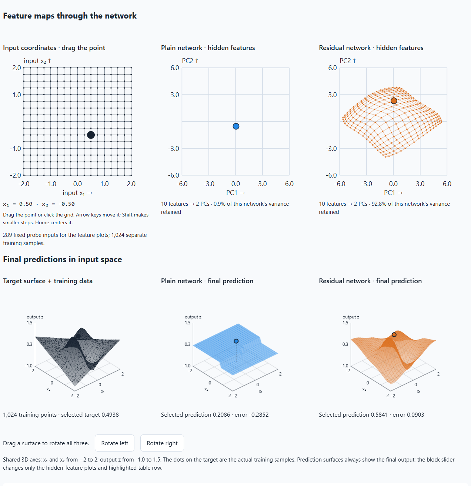
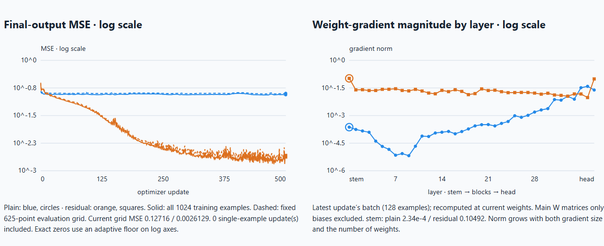

# Neuro Network Visualizer

**Watch neural networks learn. Follow their features. See where their gradients fade.**

Why does a deeper network sometimes become harder to train? What does a residual connection actually change? And what happens inside a network between its input and its answer?

Neuro Network Visualizer is a hands-on learning lab for exploring these questions. Train a plain neural network and a residual network side by side, pause whenever something looks interesting, and inspect how each one is learning.

**[Open the interactive lab →](https://liuhon33.github.io/neuro-network-visualizer/)** · **[Student guide](https://liuhon33.github.io/neuro-network-visualizer/guide.html)**

Free to explore in your browser. No account, installation, coding experience, or GPU required.

## Watch a landscape take shape

Imagine teaching a network the shape of a landscape with hills, a valley, and a saddle. Each training example gives it a location and the height at that location. Its task is to learn how to predict the height elsewhere.

The lab shows the target landscape beside the two networks' predictions. As you train, their surfaces change. You can see a hill emerge, a valley deepen, or a prediction remain nearly flat even while the network keeps receiving examples.

*An actual run: 36 hidden blocks, 10 features per layer, seed 7, and 500 updates. The upper plots show internal features; the lower plots show predicted heights over the original input coordinates. These are different views of the same models.*

For comparison, [see the same networks before training](docs/images/features-at-initialization.png).

Seeing the surface change makes “learning a function” concrete. The loss curve tells you how much error remains; the landscape shows you what that error looks like.

## Why compare with ResNet?

In 2015, Kaiming He, Xiangyu Zhang, Shaoqing Ren, and Jian Sun introduced **residual networks**, or **ResNets**, to make very deep networks easier to train. Their work evaluated image-recognition networks up to 152 layers deep, and an ensemble won the ImageNet 2015 classification competition. [Read the original paper.](https://arxiv.org/abs/1512.03385)

The central idea is approachable: a block can pass its input forward through a **shortcut**, then add a learned correction. This correction is the *residual*. A block can make a small adjustment while keeping a direct route for the incoming signal.

That route also matters during learning. A **gradient** measures how changing a weight would change the loss. In a deep network, these learning signals must travel backward through many layers and can become extremely small. Residual shortcuts provide a more direct route for them. The authors' [2016 identity-mapping study](https://arxiv.org/abs/1603.05027) examines this forward and backward flow.

This lab brings the residual idea into a small, visible function-learning task. It uses dense networks rather than reproducing the original image-recognition ResNet. You can inspect the behavior directly, without needing an image dataset or a long training run.

## Follow the learning signal

The lab connects several views so that an observation in one plot can become a question for another.

| Explore | What it helps you understand |
| --- | --- |
| **Input and hidden-feature maps** | Drag one point on the input grid and follow it through both networks. Move the block slider to see how successive layers transform the same inputs. |
| **Prediction surfaces** | Compare what each model currently predicts with the landscape it is trying to learn. Rotate the surfaces together to inspect their shape. |
| **Loss curves** | Watch prediction error over training. Does it fall steadily, fluctuate, or stop improving? |
| **Gradients across layers** | See where weight gradients are large or tiny, from the first layer to the output. Compare early layers in the plain and residual networks. |
| **Residual corrections** | Inspect the adjustment added by a selected residual block, separately from its output. |
| **Weight and gradient heatmaps** | Explore individual parameters and their gradients, with color legends and exact values. |
| **One-weight experiments** | Pause training and preview how changing one weight affects one example's loss while the other weights stay fixed. You can also explicitly train on that single example. |

*Left: how error changes over successive updates. Right: how gradient magnitude differs across layers at the displayed state. Blue is the plain network; orange is the residual network. The vertical scales are logarithmic, making very small gradients visible.*

The dots in a hidden-feature plot represent **inputs transformed by the network**, not the weights themselves. When a layer has more than two features, the lab uses PCA to show a two-dimensional summary and reports how much variation it retains. This projection can change as training progresses.

## Your first experiment

1. **Open the lab and keep the defaults:** 36 hidden blocks, with 10 features in each layer.
2. **Look before training.** Move the block slider from early to late layers. Compare how spread out the feature clouds are, then look at the gradients near the beginning of each network.
3. **Train 500 updates.** Watch the prediction surfaces and loss curves change. Pause to explore a fixed state; resume when you are ready.
4. **Follow one input.** Drag the highlighted point on the first grid. See where it goes inside each model and what height each model predicts.
5. **Ask one new question.** Try fewer blocks, a different width, or another seed. Architecture and data changes reset both networks so you can start a fresh comparison.

Use the left-hand workspace options to add details as you need them. Feature maps, prediction surfaces, loss curves, and layer-gradient curves remain visible, and the training controls stay within reach while you scroll.

The [student guide](https://liuhon33.github.io/neuro-network-visualizer/guide.html) explains the controls and offers more experiments.

## Learn by changing something and watching what happens

This project began with a desire to understand *why* residual networks work: to connect the final prediction with the features, weights, gradients, and corrections that produce it. It grew around a simple learning habit: make a prediction, change one thing, and inspect the result.

You might ask:

- Does a network lose distinctions between inputs before it has even trained?
- When the loss stops improving, are the early layers still receiving useful gradients?
- What does a residual block add to the signal it receives?
- Does changing an early weight affect the prediction differently from changing a late weight?
- How does increasing depth or width change the behavior?

Both networks see the same training examples and batches. That makes comparisons easier to interpret, while leaving room to discover how much initialization and architecture matter. Residual connections do not guarantee successful learning, and one run cannot establish which model always performs better. A smooth loss curve also does not, by itself, prove that the entire loss landscape is smooth.

The goal is to make the connection between equations and behavior something students can investigate for themselves. It is designed for independent exploration, classroom demonstrations, and conversations about what a neural network is actually doing while it learns.

## Keep exploring

- **[Play with the lab](https://liuhon33.github.io/neuro-network-visualizer/)** — start an experiment immediately.
- **[Read the student guide](https://liuhon33.github.io/neuro-network-visualizer/guide.html)** — learn the controls and how to interpret the plots.
- **[Original README and developer setup](README-legacy.md)** — preserved project structure, local setup, testing, and hosting instructions.
- **[Technical guide](docs/architecture.md)** — mathematics, implementation choices, and ideas for extending the lab.
- **[Share a question or report an issue](https://github.com/liuhon33/neuro-network-visualizer/issues)** — include your settings and what you observed.

Created by Hongrui Liu from an interactive learning project developed with AI coding assistance. Released under the [MIT License](LICENSE), so students and educators can reuse and adapt it.
