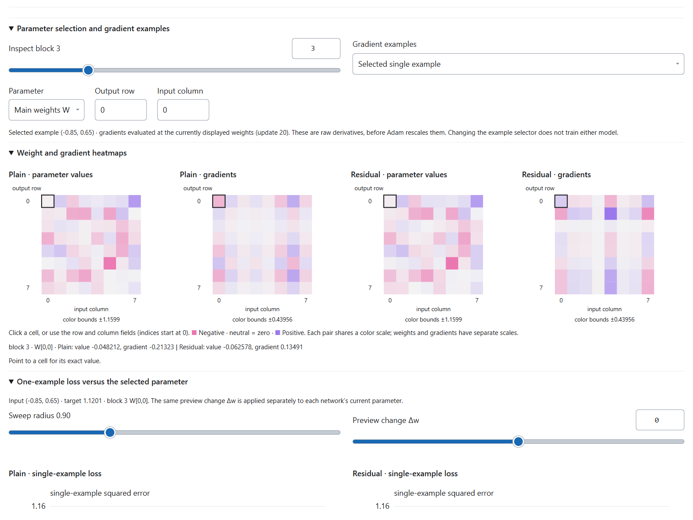

# Reusing Example 2 to study neural networks interactively

> **Public edition, October 23, 2026.** Adapted from the October 21 learning notes for the original local “Example 2” lab, the predecessor of Neuro Network Visualizer. References to “your” questions recount the collaboration with Hongrui Liu. Historical observations and measurements are retained; they are not new measurements of the public release. Links and setup instructions now target this repository. Older screenshots may show controls that have since changed. See the [publication notes and archived evidence](history/README.md).

**Use Example 2 as the main template for future network studies.** You identified its hidden-signal and parameter-inspection workflow as the most satisfactory of the experiments. This guide therefore concentrates on that implementation, its controls, its mathematical meaning, and the parts to preserve when changing architectures.

The public reference application is [Neuro Network Visualizer](https://liuhon33.github.io/neuro-network-visualizer/), derived from the original 02-two-feature-signals lab. It combines independently adjustable layers, live feature views, residual corrections, target/prediction surfaces, signed weight and gradient heatmaps, one-parameter loss curves, and explicit training steps.

The objective is to connect an input to its intermediate representations, prediction, loss, gradients, and parameter updates in one consistent state. The companion [learning summary](resnet-learning-summary.md) explains your observations. This guide is project documentation and a reusable prompt; it is not an installed Codex skill.

## Your learning approach

The following is a paraphrase of the approach expressed in your requests:

> I understand a network more effectively when I can see its computation and change it myself. I want to follow examples through the layers, compare architectures, inspect individual weights and gradients, and observe how a training step moves the prediction toward the target.

Example 2 is the preferred reference because it brings the controls and observations together. Three design choices made this practical. First, a two-input scalar function made the target visible as a surface. Second, paired models and shared examples made architectural differences easier to examine. Third, linked controls connected a selected example and parameter to several views of the same computation.

Keep this sequence when adapting the tool: an understandable task, a mathematically explicit model, a few linked views, then more detailed diagnostics prompted by a concrete question. Real-time interaction means updates at a usable cadence, with expensive inspections computed selectively.

## Open the reference experiment

Open the [public lab](https://liuhon33.github.io/neuro-network-visualizer/). For offline use, download this repository and open `index.html`; no Python server is required.

| File or directory | Purpose |
| --- | --- |
| [src/](../src/) | Current application source, derived from Example 2. |
| [dense-engine.js](../src/dense-engine.js) | Model, gradients, optimizer, parameter slices, and PCA. |
| [inspector.js](../src/inspector.js) | Heatmaps, selected-parameter experiments, and learning diagnostics. |
| [Archived evidence](history/README.md) | Historical browser reports, numerical checks, and screenshot provenance. |
| [Developer setup](../README-legacy.md) | Current local setup, build, and test instructions. |

Training state lives in browser memory; refreshing the page does not restore a trained checkpoint. The current tool has no checkpoint export/import control.

## A first session with Example 2

1. Start with three blocks, set all widths to 2, and initialize. Follow one input through the stem and successive blocks using the block slider.
2. Compare the hidden clouds with the added correction. Inspect the raw signal values when you want the exact computation.
3. Increase widths to 10 and initialize again. Read the PCA variance-retention labels before interpreting apparent compression or motion.
4. Train in small increments. Compare the target and final predictions, then inspect full-training and fixed-grid loss at the bottom.
5. Pause, choose the selected-single-example gradient source, select a layer and weight, and compare its signed gradient with the tangent of its loss curve.
6. Move the preview slider, then return it to zero. Use the one-example training button only when you want to change the models.
7. To revisit vanishing gradients, reset to seed 7, 36 blocks, all widths 10, and 1,024 examples. Inspect initialization and the first 500 updates. The quantitative reference is in the [learning summary](resnet-learning-summary.md).

Use the left workspace selector to show optional views. Core plots remain visible and the training controls stay accessible. Width and depth changes reset both networks, so make architecture comparisons as separate runs.

## How Example 2 is implemented

| Approach | Role in this lab | Why it matters |
| --- | --- | --- |
| Explicit JavaScript numerical engine | Forward pass, backpropagation, Adam, loss evaluation, and parameter sweeps | The model is small enough to inspect and compute directly in the browser. |
| Float64Array storage | Parameters, activations, gradients, and optimizer moments | Makes numerical state explicit and supports precise reference comparisons. |
| Shared model state with separate views | The same networks and selected example drive the plots, tables, and controls | Prevents disconnected demonstrations from showing different computations. |
| PyTorch and NumPy reference calculations | Check derivatives, optimizer updates, and PCA | Establishes that a plausible picture corresponds to the intended mathematics. |
| Standalone HTML export | Embeds the model and inspector into a portable page | Ordinary use needs no Python training server or cloud service. |

Training in Example 2 happens in JavaScript. The original study used a conda environment named `pytorch_learn` for independent Python reference checks; the page does not call PyTorch on each update. Readers can use their own suitable PyTorch environment for new reference checks.

## Visualization tools and skills used for Example 2

| Tool or technique | Role |
| --- | --- |
| HTML and CSS | Readable sliders and number inputs, responsive layout, theme styling, and foldable sections. |
| SVG | Hidden-feature grids, highlighted inputs, parameter heatmaps, loss curves, and gradient charts. |
| Canvas 2D | Rotatable target and prediction surfaces, using explicit projection of 3D grid points. |
| Live PCA | A shared projection for the two hidden-feature clouds and a separate projection for the residual correction. |
| Browser inspection and screenshots | Checks that controls, plots, themes, and narrow layouts remain usable. |
| Chrome DevTools Protocol and websocket-client | Repeatable tests of the actual served page using an isolated browser profile. |
| Visualization authoring skill | Guidance for constructing the interactive HTML tool. |
| Browser-control skill | Browser-testing workflow when its runtime is available; the saved CDP checks also provide reproducible validation. |

The renderer uses custom SVG and Canvas. Example 2 does not depend on Plotly, D3, Three.js, TensorBoard, or TensorFlow.js. Keep the distinction between mathematical computation and rendering when extending it: changing a plot or folding a section must not change the model.

## Exact model definition for Example 2

### Dense networks

Example 2 learns this smooth target on $[-2,2]^2$:

$$
\begin{aligned}
f(x_1,x_2)={}&1.3e^{-2.3((x_1+0.8)^2+(x_2-0.5)^2)}
+0.9e^{-3((x_1-0.9)^2+(x_2+0.6)^2)}\\
&-1.05e^{-2.8((x_1-0.45)^2+(x_2-0.9)^2)}
+0.18x_1x_2.
\end{aligned}
$$

Its bumps, valley, and interaction term make errors visible in different regions. With $B$ hidden blocks and widths $d_0,\ldots,d_B$, the stem maps 2 inputs to $d_0$ features. Block $i$ maps $d_{i-1}$ to $d_i$, and the head maps $d_B$ to one scalar.

The stem is tanh. A plain block computes $\tanh(W_i h+b_i)$. A residual block computes

$$
h_{\mathrm{out}}=
\begin{cases}
h+\alpha\tanh(W_i h+b_i),&d_i=d_{i-1},\\
P_i h+\alpha\tanh(W_i h+b_i),&d_i\ne d_{i-1},
\end{cases}
\qquad \alpha=B^{-1/2}.
$$

$P_i$ is a trainable, bias-free rectangular identity at initialization. Narrowing can discard information, and these projections add parameters. Main-branch weights use Gaussian initialization with standard deviation $\sqrt{2/(n_{\mathrm{in}}+n_{\mathrm{out}})}$ and zero biases. Corresponding main-branch weights start identically in both models.

The plain parameter count is

$$
3d_0+\sum_{i=1}^{B}d_i(d_{i-1}+1)+d_B+1.
$$

Add $d_id_{i-1}$ for each width-changing residual shortcut. The counts include biases.

| Configuration | Stem | Each block | Head | Total per equal-width model |
| --- | ---: | ---: | ---: | ---: |
| Width 2, 3 blocks | 6 | 6 | 3 | 27 |
| Width 2, 12 blocks | 6 | 6 | 3 | 81 |
| Width 10, 36 blocks | 30 | 110 | 11 | 4,001 |
| Width 16, 12 blocks | 48 | 272 | 17 | 3,329 |

The page exposes widths 1–32, including the stem, and 3/12/24/36 blocks. Its UI uses Adam 0.003. The numerical engine supports SGD too, but there is no SGD selector in this page. Changing the optimizer through a future control would require explicit reset semantics.

The dense pair changes both the shortcut and the residual branch scale. For a strict skip-only ablation, make branch scaling an independently controlled factor rather than attributing every difference solely to the identity addition.

Implementation: [dense-engine.js](../src/dense-engine.js), especially the Net constructor, forward, gradients, and update methods.

## Keep the three kinds of data separate

Lab 02 deliberately separates:

| Data | Current setup | Purpose |
| --- | --- | --- |
| Training examples | Default 1,024; adjustable 128–4,096; fixed-seed uniform draws | Supply supervised updates and full-training MSE. |
| Feature probes | Fixed 17×17 grid, 289 points | Follow the same inputs through every selected hidden mapping. |
| Evaluation grid | Fixed 25×25 grid, 625 points | Draw prediction surfaces and track error on points separate from the training sample. |

Both networks receive the same shuffled batches of 128, visiting every training example before reshuffling. The selected input is a separate probe unless an explicit one-example update uses it. That update does not append it to the dataset.

Keep these three datasets distinct when adapting the lab. Increasing training data should not silently change the feature probes or evaluation grid; otherwise the pictures may change because the inspected inputs changed.

## Linked views and interaction rules

### Representations and predictions

The selected input marker appears in the input grid, both hidden representations, and the residual correction view. Connections retain the neighborhood structure of the original probe grid. The hidden block selector changes the representation view; the three surfaces below always show the target and the two final predictions.

Widths 1 and 2 use direct coordinates. Wider layers use centered PCA, computed by a Jacobi eigensolver for the small covariance matrix. The two networks share a PCA basis fitted to pooled probe activations; each reports its own retained variance. The correction view fits a separate PCA and marks the projected zero correction.

Live refitting and sign alignment are implemented. A fixed PCA basis and more complete alignment across time would be useful future comparison modes; they are not current controls.

### Parameters and gradients

The layer slider covers the stem, all hidden blocks, and the head. Choose main weights, biases, or a learned shortcut, then click a heatmap cell or enter its zero-based row and column. Identity shortcuts have no trainable matrix.

Weight heatmaps share a color range across models. Gradient heatmaps share another range. Signed colors and exact numerical values prevent a low-contrast display from being mistaken for an exact zero.

The gradient source is explicit: latest update's examples, full training set, or selected single example. In Lab 02, all three are recomputed at the current weights. Before the first update, the batch choice previews the first batch without consuming it.

The bottom gradient chart reports main-weight Frobenius norms or RMS:

$$
\|G\|_F=\sqrt{\sum_{i,j}G_{ij}^2},
\qquad
\operatorname{RMS}(G)=\frac{\|G\|_F}{\sqrt{\#G}}.
$$

Biases are excluded from that chart; learned shortcut gradients have separate markers. Log axes retain tiny positive values. Exact zeros use a clearly handled plotting floor.

Preserve this timing rule in future implementations: label both the examples supplying a gradient and the model state at which it was evaluated. A gradient computed before an update should not be presented as if it described the newly updated weights.

### Read-only parameter experiments

For a selected example $(x,y)$, parameter vector $\theta$, coordinate $k$, and current value $\theta_k$, a loss slice evaluates

$$
\ell_k(w)=\ell\!\left(f_{\theta+(w-\theta_k)e_k}(x),y\right).
$$

Only coordinate $k$ varies. Lab 02 shows both curves, current dots, preview diamonds, and local gradient tangents. The radius slider controls the sweep; the preview applies the same temporary offset to each model's own current value.

Preview evaluation restores the original value even if evaluation fails. It must not change optimizer moments, update counters, dataset order, or history. An explicit one-example button performs a real Adam update on **all trainable parameters** of both models using existing optimizer state. Selecting one weight for inspection does not restrict that training step to one weight.

If you later add trajectory overlays or two-parameter surfaces, record the checkpoint defining the frozen parameters. Historical training points need not lie on a slice drawn at the current checkpoint, because the other parameters changed during training. Example 2 currently provides one-parameter curves.

### View selection and reset behavior

The original Lab 02 had ten foldable panels and Fold all/Expand all controls. The public version uses a left workspace selector for optional views, keeps the core feature/prediction and learning plots visible, and provides a persistent training bar. Changing view visibility preserves model and optimizer state.

Changing architecture, sample count, or seed resets both models. Merely changing the inspected layer, input example, selected parameter, or folded sections does not train them. The live PCA is refitted as needed for display. Keep these observation-only actions separate from training in future versions.

## A repeatable experiment protocol

1. **State one question.** For example: does increasing depth attenuate early backward sensitivity before training?
2. **Specify the comparison.** Record architecture, activation, residual scale, initialization, data, optimizer, rate, batch size, and evaluation mode. Decide what is intentionally different.
3. **Start from a known state.** Reset both models and optimizer state for independent runs. Preserve the same data and batch sequence where meaningful.
4. **Inspect initialization.** Look at representations, predictions, raw gradients, and sensitivity before attributing an effect to learning.
5. **Take one step.** Compare the predicted sign of a selected parameter's effect with the actual result. With Adam, account for moments rather than assuming every step is proportional to the current gradient.
6. **Train to recorded checkpoints.** Compare full-set loss, fixed-grid error, and gradients at 0, 1, 10, 100, and later updates. Keep the chosen example fixed when testing its sensitivity.
7. **Pause and intervene.** Sweep one parameter with all others fixed, then separately try a real one-example update.
8. **Challenge the interpretation.** Repeat across seeds or batches; inspect unprojected values; compare full-batch updates; test whether a display-scale choice explains the apparent effect.
9. **Save a run record.** Store settings, data identity, checkpoint weights, optimizer/RNG state, diagnostics, and the observation. Dense checkpoint export is a future extension; currently those browser states are transient.

For the 36-block example discussed in the summary, reproduce widths as a 37-entry array of 10s: one stem plus 36 blocks. Use initialization seed 7, training-data seed 1234, 1,024 examples, batch-order RNG seeded with $7\mathbin{\mathrm{XOR}}\texttt{0x2a7f19}$, batches of 128 without replacement, and Adam 0.003. Inspect the prediction at $(0.5,-0.5)$ at steps 0, 100, and 500. The sensitivity ratio compares derivatives with respect to the stem output and final hidden state; it is not currently a separate on-screen chart.

## How we verified the tools

Visual plausibility is insufficient for a learning tool: a wrong gradient can generate a convincing animation. The checks covered several levels.

| Check | Saved evidence |
| --- | --- |
| Analytic gradients versus central finite differences | 1,268 checks over 16 dense architecture cases; maximum absolute discrepancy about $1.63\times10^{-9}$. |
| Dense gradients and Adam updates versus PyTorch | Maximum gradient discrepancy about $6.66\times10^{-16}$ and update discrepancy about $2.22\times10^{-16}$ in the checked cases. |
| PCA versus NumPy | Eigenvalues, orthogonality, eigenvector residuals, and sign continuity checked. |
| Selected-weight slices | Numerical slope versus analytic derivative; original parameters and optimizer state restored. |
| Actual browser page | Served export compared with saved bytes; real controls, updates, layouts, and fold behavior exercised. |

Sources: [dense numerical report](history/numerics.json) and [signal-inspector browser report](history/inspector-verification.json). Error values describe the tested inputs and numerical precision, not every possible model state. If adapting to ReLU or float32 computation, use appropriate finite-difference tolerances.

When two long training runs diverge, compare their derivatives at **the same checkpoint** before diagnosing an implementation error. Small numerical differences can change later trajectories; matching a single checkpoint's forward/backward computation is a more direct test.

## Editing and rebuilding

The public repository separates the numerical engine, inspection tools, and page layout:

| Source | Responsibility |
| --- | --- |
| [dense-engine.js](../src/dense-engine.js) | Parameters, forward pass, backpropagation, optimizer, loss slices, and PCA. |
| [inspector.js](../src/inspector.js) | Gradient sources, heatmaps, parameter curves, history, and one-example updates. |
| [lab.js](../src/lab.js), [lab.html](../src/lab.html), [lab.css](../src/lab.css) | Controls, feature/surface views, and layout. |
| [build.py](../scripts/build.py) | Builds the standalone application and student-guide pages. |

From the repository root:

~~~sh
python scripts/build.py
node tests/numerics.cjs
~~~

Optional browser checks use Chrome/Chromium and Python's `websocket-client` package:

~~~sh
python -m pip install websocket-client
python tests/browser_smoke.py
~~~

The browser test starts its own isolated browser and local server. Reports and screenshots are regenerated in the ignored `verification/` directory. The reports in [history/](history/README.md) are preserved records from the original lab, not outputs of these current test commands. See the [technical guide](architecture.md#verification-and-limitations) for current verification scope.

## Adapting the approach to another architecture

Preserve Example 2's interaction pattern while replacing the architecture-specific computation. Keep the interface between the mathematical engine and the views small. The following is a proposed interface for a future reusable engine, not an API already implemented in full:

~~~text
initialize(config, seed)
forward(input, captureIntermediateValues)
loss(examples, objective)
gradients(examples, objective)
trainStep(examples, optimizerState)
listParameters() -> names, shapes, counts, trainability
inspectParameter(name, index)
previewParameterSlice(name, index, values, example)
snapshot() / restore(snapshot)
~~~

A snapshot should include weights, optimizer moments, step counters, RNG state, batch position, and mutable model buffers. Otherwise restoring only the weights may fail to reproduce the next update.

| New architecture | Views that transfer | Additional quantities to expose |
| --- | --- | --- |
| CNN | Loss/gradient charts, parameter slices, feature summaries | Individual channels, filters, pooling, spatial resolution, receptive-field probes. |
| Transformer | Residual correction views, parameter inspection, learning histories | Token embeddings, attention matrices, query/key/value tensors, normalization, MLP outputs. Attention weights alone are not a complete explanation of a prediction. |
| RNN or LSTM | Fixed-example traces, gradients, controlled perturbations | Hidden and cell states by time, gates, gradient magnitude across time steps. |
| Autoencoder | Input/output comparison, latent projections, loss curves | Encoder/decoder stages, reconstruction errors, interpolation through latent space. |
| Normalization or activation comparison | Paired representations and update diagnostics | Pre/post-normalization statistics, saturation fractions, derivative distributions. |

Useful additions would be checkpoint export/import, a fixed-versus-live PCA option, actual update-to-weight ratios, backward activation gradients, and selected Jacobian singular values. Treat each as a diagnostic for a specific question rather than adding every plot at once.

For larger models, capture selected tensors, throttle redraws, cache frozen slices, and explicitly dispose of temporary tensors. Separate rendering time from training time. Record whether normalization buffers and dropout are fixed during an inspection so that repeated evaluations answer the same question.

## A reusable prompt for the next study

~~~text
Help me build an interactive learning experiment for [architecture].
Use Neuro Network Visualizer (derived from Example 2) as the design reference.
It is the experiment I was most satisfied with. Preserve its linked
inspection workflow: input -> hidden features -> block correction ->
final prediction -> loss -> gradients -> explicit parameter update.
Use its technical playbook and public source code. Other historical
labs are not included in the public repository.
Keep the work under [my chosen project directory] in a clearly named
folder. Reuse an existing PyTorch environment for Python training or
numerical reference checks when suitable.

My learning question is: [specific phenomenon].
My target task is: [simple function, image task, sequence task, etc.].
Compare [model A] and [model B], explaining precisely what differs.

Start by clarifying consequential ambiguities: the task and target,
layer definitions, width changes, optimizer, loss, gradient examples,
whether controls preview or train, and what resets the models.
Use reasonable defaults for routine interface details.

Make the network inspectable:
- Show layer shapes and trainable parameter counts.
- Preserve independent layer widths and a global width control where
  meaningful; clearly state which architecture edits reset both models.
- Follow one selected input through intermediate representations.
- Show any residual correction or other architecture-specific operation.
- Display targets, final predictions, and training/evaluation loss.
- Show signed parameter and gradient values with exact-value inspection.
- Let me select gradient examples: a batch, full set, or one example.
- Distinguish raw gradients from actual optimizer updates.
- Support a frozen one-parameter loss slice and a read-only preview.
- Provide an explicit one-example training step.
- Use PCA only where needed, disclose the basis and retained variance,
  and preserve access to raw values.
- Make controls readable; let me select optional views while core plots
  and training controls remain easy to reach.
- Keep loss histories and layerwise gradient magnitudes together at
  the bottom, with clear training/evaluation and gradient-source labels.

Use shared data and controlled initialization where meaningful.
Record all settings, reset semantics, and checkpoint timing.
Do not imply different pretrained architectures isolate one design choice.
Separate implemented features from proposed extensions.

Verify the mathematics using finite differences and an independent
reference where feasible. Test the actual served web page, including
state preservation during previews and view selection. Keep model assets,
source code, reproduction commands, and verification reports together.

Help me interpret observations as hypotheses to test. Explain which
measurements support an explanation and which mechanisms remain uncertain.
~~~

The same workflow can support future studies of architecture, initialization, optimization, and generalization. Its value comes from connecting a visible change to a well-defined computation and a controlled intervention.

## Optional supporting experiments

These labs belonged to the original local collection and are not included in this public repository. They suggest directions to explore when a question goes beyond the reference tool:

| Supporting lab | What to borrow |
| --- | --- |
| 01 Function regression (historical) | Adam/SGD and learning-rate controls, with explicit independent-run resets. |
| 03 MNIST CNN (historical) | Image-class probabilities, initial/trained checkpoints, and fixed two-weight surfaces. |
| 04 ImageNet flow lab (historical) | PyTorch export, TensorFlow.js browser computation, and selected probes for larger pretrained models. |

Their training data, objectives, and architectures differ from Example 2. For classification extensions, distinguish the actual probability, a desired target probability, and the loss minimized to reach that target. For larger pretrained models, inspect selected tensors and preserve evaluation-mode details. Keep Example 2's controllable, linked views as the design foundation.
