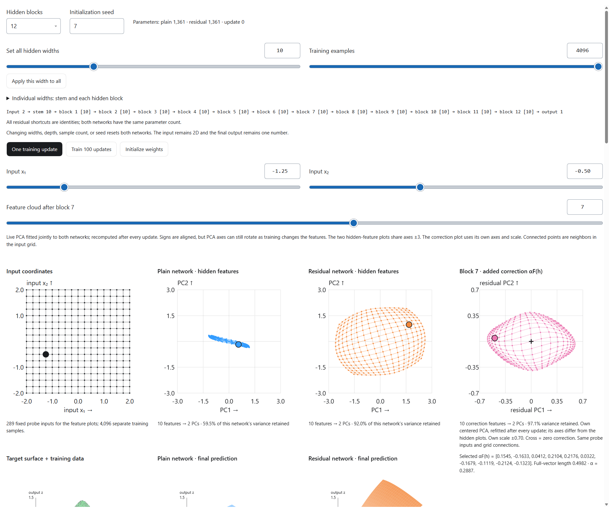

# What we learned from the hidden signal and parameter inspection lab

> **Public edition, October 23, 2026.** Adapted from the October 21 learning notes for the original local “Example 2” lab, the predecessor of Neuro Network Visualizer. References to “your” questions recount the collaboration with Hongrui Liu. Historical observations and measurements are retained; they are not new measurements of the public release. Links and setup instructions now target this repository. Older screenshots may show controls that have since changed. See the [publication notes and archived evidence](history/README.md).

**Example 2 is the main reference for this study.** You identified it as the experiment you were most satisfied with: it brings hidden features, residual corrections, final predictions, weights, gradients, and loss into one interactive view.

The original lab's public successor is [Neuro Network Visualizer](https://liuhon33.github.io/neuro-network-visualizer/). It learns a two-input scalar function with paired plain and residual networks. Its value is that you can pause at a known state, follow one input through the model, inspect a selected parameter, preview a change, and then take a real training step.

Your central insight was to study a network by interacting with its computation. A final accuracy score cannot show where information disappears, which parameters receive a useful gradient, or what a particular update changes. Example 2 makes those questions testable.

This synthesis covers the discussion and saved implementation through October 21, 2026. The companion [technical playbook](neural-network-visualization-playbook.md) uses this lab as the template for future architectures. The other experiments appear only as supporting context at the end.

## How your questions shaped Example 2

You began with a [video about neural networks and loss landscapes](https://www.youtube.com/watch?v=QgH9sr7G13Q) and screenshots showing probability versus selected weights and a loss surface. Your question was whether we could reproduce that kind of exploration ourselves, first with simple numerical examples and then with image classifiers.

You proposed a particularly useful simplification: learn a function from two inputs to one output. Its target and prediction can both be drawn as surfaces. You wanted to see how the internal signals and the final surface change after each update, rather than seeing only the finished fit.

Your questions then led to several extensions:

| Your question or observation, paraphrased | What it added |
| --- | --- |
| What exactly is the network, and how many parameters are there? | Explicit layer shapes and parameter counts. |
| Can I follow the same input before and after each block? | Hidden-feature clouds, connected input-grid neighbors, and a highlighted input. |
| Can widths differ between blocks, while still allowing one control for all widths? | Independent and global width controls, with both models reset together. |
| Can we still visualize more than two features? | Live PCA, variance-retention labels, and raw feature values. |
| Can I see what the residual branch actually adds? | A separate plot of the scaled correction $\alpha F(h)$. |
| What happens when the network becomes much deeper? | 24/36-block options, loss histories, and layerwise gradient inspection. |
| Can I inspect a weight and its relationship to one example's loss? | Weight and gradient heatmaps, coordinate sweeps, previews, and an explicit one-example training step. |
| Can the page remain usable as the experiment grows? | Larger controls, responsive plots, and foldable sections. |

Your current statement captures the purpose: “it will enable me to view every possible parameters, weights, gradients, feature map, final output, loss etc in real time.” The practical goal is to make each quantity accessible through selection and inspection. Larger networks require summaries and selective computation; displaying every tensor simultaneously would become unreadable and expensive.

## The experiment to return to

Open the [public lab](https://liuhon33.github.io/neuro-network-visualizer/), or download this repository and open `index.html` in a browser. The [student guide](https://liuhon33.github.io/neuro-network-visualizer/guide.html) explains the current controls.

The input stays two-dimensional and the final output stays one number. The hidden widths are independently adjustable from 1 to 32, with a global control to set them together. Depth can be 3, 12, 24, or 36 blocks. Architecture changes reset both models, making it possible to compare their behavior from initialization.

The views answer complementary questions:

| View | Question it helps answer |
| --- | --- |
| Input grid and highlighted input | Which examples are we following, and which neighbors began close together? |
| Plain and residual hidden-feature clouds | How does the selected block transform those examples? |
| Added correction $\alpha F(h)$ | What does the residual branch contribute beyond the shortcut? |
| Target and two final prediction surfaces | What function has each complete network learned? |
| Weight and gradient heatmaps | Which parameter is being inspected, and how does the chosen loss depend on it? |
| Single-example loss versus one parameter | What happens if only this parameter changes while all others stay fixed? |
| Loss history and layerwise gradient magnitude | Is learning progressing, and where are backward signals weak? |

The feature grid, training examples, and evaluation grid serve different purposes. The fixed 289-point feature grid makes transformations comparable. The adjustable training set supplies updates. A separate 625-point grid shows the target and final predictions.

A useful learning session is to initialize, inspect the clouds across blocks, take one update, and inspect the changes. Then pause at a particular input, select a weight, compare its gradient with the local loss-curve slope, and try the explicit one-example step. The preview changes only the inspected parameter temporarily; that training button updates all trainable parameters.

These connections between views are the part to preserve when studying a different architecture. The controls let you ask a question and intervene; the plots show several consequences of the same state.

## The mathematical pieces behind the pictures

### Forward representations and backward sensitivity

Let $h_l$ be the column vector entering a block, and let $F_l$ be its learned transformation. A plain block replaces its input:

$$
h_{l+1}=F_l(h_l).
$$

An equal-width residual block in our dense labs adds a correction:

$$
h_{l+1}=h_l+\alpha F_l(h_l),
\qquad
\alpha=\frac{1}{\sqrt B},
$$

where $B$ is the number of hidden blocks. Here $F_l(h)=\tanh(W_lh+b_l)$. The stem is an ordinary tanh layer; the final head is linear.

These are the actual definitions in [the dense numerical engine](../src/dense-engine.js). The choice of residual scale is part of this experiment, not a universal requirement for ResNet.

Write $J_l=\partial F_l/\partial h_l$ for the block's Jacobian, the matrix describing how a small input change affects its output. The chain rule gives

$$
\nabla_{h_l}L=
\begin{cases}
J_l^\mathsf T\nabla_{h_{l+1}}L,&\text{plain},\\
(I+\alpha J_l)^\mathsf T\nabla_{h_{l+1}}L,&\text{residual}.
\end{cases}
$$

Across many plain blocks, backward signals pass through a product of Jacobians. Repeated contraction can make early signals tiny. The identity term in a residual block provides a direct contribution to the backward signal. This is the connection between the forward “preserve and correct” picture and the backward propagation picture. See the analysis of identity paths in [Identity Mappings in Deep Residual Networks](https://arxiv.org/html/1603.05027v3#S2).

A simple scalar calculation makes the multiplication visible. If each of 36 plain blocks has local derivative $0.5$, the total derivative is $0.5^{36}\approx1.46\times10^{-11}$. If each residual block instead has derivative $1+0.01$, the product is $1.01^{36}\approx1.43$. These are illustrative derivatives, not measurements of the trained network.

Residual connections do not guarantee successful gradients. In a scalar block, a correction derivative of $-1$ with $\alpha=1$ cancels the identity completely. Large positive derivatives can produce explosion. More generally, if $\|\alpha J_l\|_2\leq\epsilon<1$, then

$$
(1-\epsilon)\|v\|_2
\leq \|(I+\alpha J_l)v\|_2
\leq (1+\epsilon)\|v\|_2.
$$

This follows from the triangle and reverse-triangle inequalities. It explains why a small correction Jacobian preserves local distances, while repeated products can still accumulate substantial distortion.

Example 2 has no activation after the residual addition. When adapting the experiment to a block with an activation after addition, include that activation's derivative too; the displayed computation must match the actual architecture.

### Why the plain feature cloud gathered together

The points in the hidden plots are **activations for different input examples**, not the weights. Weights define the mapping that moves those points.

In the plain network, repeated random linear transformations and tanh nonlinearities can compress distinctions between inputs. For tanh, the derivative is $1-\tanh^2(z)$; saturated coordinates have derivatives close to zero. The complete Jacobian also contains the weight matrix, so contraction is a property of the combined transformation, not a consequence of tanh alone.

With small residual corrections, different inputs retain more of their existing separation. That explains the more spread-out residual cloud observed at initialization. A spread-out cloud does not mean the target function has already been learned.

This saved initialization view shows the input grid, the two hidden clouds, and the selected block's correction. It is a feature-view example, not the 36-block measurement below.

### What PCA lets us see

For a wide layer, PCA projects its feature vectors onto two directions of high variation. The main hidden plots use one PCA fitted jointly to both networks' probe activations. Sharing axes makes their displayed spread more comparable.

PCA is recomputed during training. Aligning eigenvector signs reduces sudden flips, but axes can still rotate or exchange order. Apparent motion can therefore combine actual feature changes with changes in the viewing coordinates. A narrow-looking projection can also hide variation outside the first two components; the variance-retention label helps interpret this.

The residual correction cloud uses its own PCA and scale. Its displayed coordinates cannot simply be added to the neighboring hidden-feature plot. The identity

$$
h_{\mathrm{out}}=\text{shortcut}(h_{\mathrm{in}})+\alpha F(h_{\mathrm{in}})
$$

holds in the original feature space. The raw values remain available for that comparison.

## What Example 2 showed at 36 blocks

You observed the problem immediately after initialization and during approximately the first 500 steps with all hidden widths set to 10. The numerical check reported in our discussion used Example 2, seed 7, 1,024 training examples, shared shuffled batches of 128, and Adam 0.003. Both models had 4,001 parameters.

| Full-training MSE | Plain | Residual |
| --- | ---: | ---: |
| Initialization | 0.138734 | 0.228980 |
| Update 100 | 0.119665 | 0.047727 |
| Update 500 | 0.123327 | 0.002362 |

To distinguish backward attenuation from a merely small prediction error, we also examined the prediction itself at the fixed input $(0.5,-0.5)$:

$$
R=
\frac{\|\nabla_{h_{\mathrm{stem}}}\widehat y\|_2}
{\|\nabla_{h_{\mathrm{final}}}\widehat y\|_2}.
$$

| Checkpoint | Plain $R$ | Residual $R$ |
| --- | ---: | ---: |
| Initialization | $9.975\times10^{-3}$ | 1.509 |
| Update 100 | $4.426\times10^{-5}$ | 1.269 |
| Update 500 | $4.406\times10^{-6}$ | 3.355 |

For this input, the plain model's backward sensitivity was about 100 times smaller at the stem initially and about 227,000 times smaller after 500 updates. The residual model preserved this sensitivity. PyTorch evaluation of the same JavaScript checkpoint matched the gradients numerically.

These values were reported during the conversation; this section preserves that record. The specific 500-step checkpoint was not saved as a standalone model artifact. The technical playbook records the reproduction settings. The result supports your diagnosis at the checked points; it does not prove monotone attenuation at every layer, input, or intervening update.

## Reading the plots correctly

Several distinctions became important as the tool grew:

| Quantity | Meaning and interpretation |
| --- | --- |
| Target or prediction surface | Height is $f(x_1,x_2)$ or $\widehat f_\theta(x_1,x_2)$. Its horizontal axes are input coordinates. |
| Parameter loss surface | Height is loss; horizontal axes are selected weights or directions in parameter space. |
| Hidden-feature plot | Shows the internal representation, not a scalar prediction at that block. Only the final output is supervised; the surfaces below show that final prediction. |
| Weight gradient | Sensitivity of a specified loss to a weight. It depends on the selected examples and their aggregation. |
| Actual optimizer update | The parameter displacement after SGD or Adam. It can differ substantially from the raw gradient. |
| Gradient norm | A summary that can hide signs and cancellation. Frobenius norms also depend on the number of entries; RMS offers a size-adjusted comparison. |
| One-weight curve | A conditional slice with all other weights fixed. During training, other weights change and the slice itself changes. |
| Low-dimensional loss view | A slice through a much higher-dimensional function. A smooth-looking selected slice does not establish global convexity. Example 2 currently uses one-parameter curves. |

There is a precise reason a final-layer loss can look simpler. With earlier features fixed, squared error for a linear head is a convex quadratic in that head's weights and bias. Allowing earlier layers to change introduces nonlinear composition. This does not imply that every early-layer slice is bumpy or that a plain deep network is unoptimizable.

Example 2 uses mean squared error on the chosen examples. A gradient may be small because the prediction is already accurate, because examples' gradients cancel, or because backward sensitivity is attenuated. Choose the same gradient source when comparing models, and use prediction sensitivity when the question is specifically about propagation rather than loss magnitude.

The inspector shows raw derivatives before Adam's rescaling. A one-example update retains the existing optimizer moments, so its displacement need not be proportional to the current gradient. Previewing a coordinate and performing a training step are deliberately separate operations.

Loss-landscape comparisons also depend on parameter scaling and chosen directions. The paper [Visualizing the Loss Landscape of Neural Nets](https://arxiv.org/html/1712.09913v3) develops filter normalization and discusses the limits of interpreting low-dimensional views.

## What to investigate next in this lab

For stronger causal comparisons, vary skip connections and residual scaling separately, repeat across seeds, and distinguish optimization speed from error on the fixed evaluation grid. Width-changing shortcuts add parameters and may lose information when narrowing, so equal depth alone does not imply an equal comparison.

The most useful extensions would build on the current workflow: saved checkpoints, a fixed-versus-live PCA option, actual parameter-update magnitudes, and backward activation sensitivities. These are future additions; the current tool already supports the forward features, parameter gradients, and controlled previews described above.

## Supporting lessons from the other experiments

The first function-regression lab supplied the optimizer comparison. Your Adam 0.03 versus 0.003 observations showed why learning rate can change the optimization trajectory. Browser checks also corrected the initial impression that SGD could not learn: at SGD 0.03 and 1,500 updates, the plain/residual full-training MSEs were approximately 0.0113/0.0120. The larger fluctuations you observed with SGD 0.01 are consistent with differences in update sensitivity and curvature, but the plots alone do not identify the cause of each spike. See the [saved browser comparison](history/function-sgd-verification.json).

The MNIST and ImageNet tools extend parameter-loss inspection to images. They are optional follow-ons to Example 2. The saved MNIST run did not show a universal residual advantage, and the pretrained ImageNet models are different architectures rather than a skip-only comparison. Those image labs belong to the original local experiment collection and are not included in this public release. They are recorded here as context and possible directions for future studies.

Your reusable learning method is already clear: predict what should happen, inspect a fixed state, intervene on one factor, observe both forward and backward changes, and check the interpretation numerically. That method can be carried to other architectures without assuming that their behavior will match ResNet.
